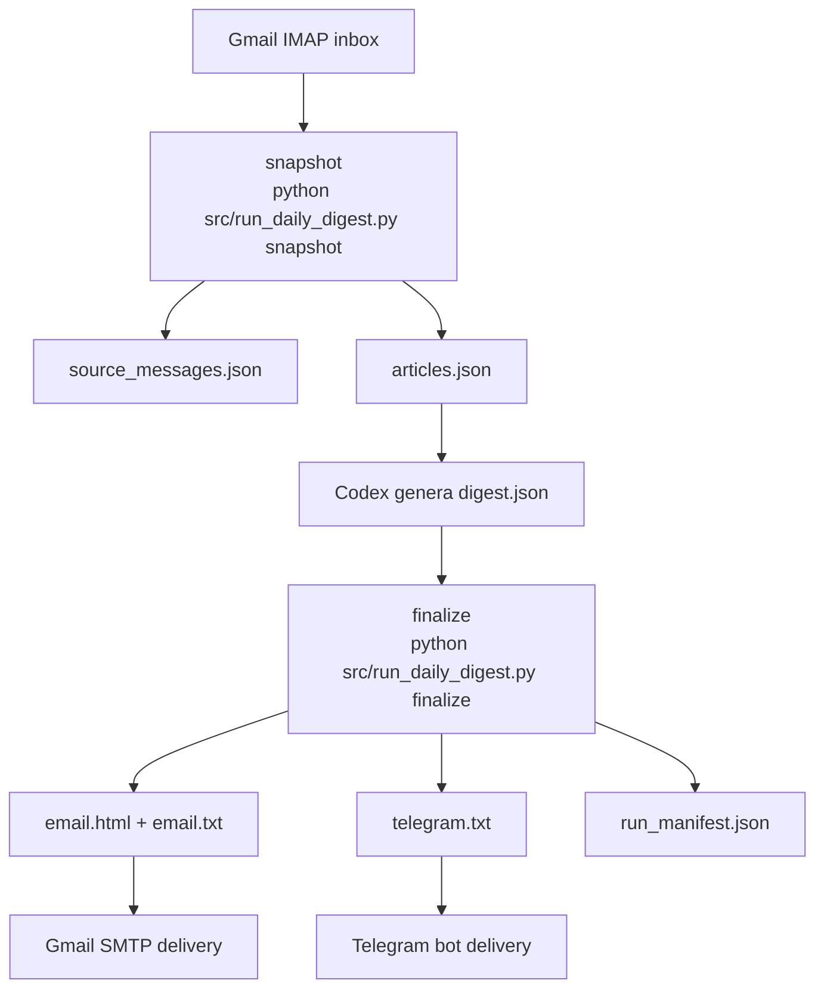

# TLDR Digest Extractor

Pipeline para publicar un digest diario de newsletters TLDR-family con snapshot fijo a las `17:00` en `Europe/Madrid`.

## Objetivo

Evitar depender del cuerpo truncado de Gmail/Outlook y dejar de usar el mensaje de Codex como entrega final. El flujo de producción recomendado es:

```text
Gmail IMAP
  -> detectar newsletters TLDR-family llegadas antes de las 17:00 Madrid
  -> extraer URLs View Online
  -> ejecutar extractor sobre esas URLs
  -> obtener articles.json
  -> generar digest.json en Codex
  -> renderizar email.html + telegram.txt
  -> enviar HTML a Gmail y resumen híbrido a Telegram
```

## Arquitectura actual



## Instalación

```bash
python -m venv .venv
source .venv/bin/activate  # Windows: .venv\Scripts\activate
pip install -r requirements.txt
```

## Uso básico del extractor

```bash
python src/extract_tldr.py \
  --url "https://a.tldrnewsletter.com/web-version?..." \
  --url "https://a.tldrnewsletter.com/web-version?..." \
  --out output/articles.json \
  --log-level INFO
```

Por defecto el extractor:

- resuelve `links.tldrnewsletter.com` a la URL final del artículo;
- elimina params de tracking comunes;
- excluye sponsors del JSON final;
- deduplica noticias repetidas entre newsletters por URL canónica y por similitud temática del título/resumen.

## Pipeline diario

### Variables de entorno

Configura al menos estas variables:

```bash
TLDR_FEEDS=TLDR,TLDR AI,TLDR Data,TLDR DevOps,TLDR IT
DIGEST_TIMEZONE=Europe/Madrid
DIGEST_CUTOFF_HOUR=17

GMAIL_ADDRESS=...
GMAIL_APP_PASSWORD=...
DIGEST_TO_EMAIL=...
DIGEST_FROM_EMAIL=...

TELEGRAM_BOT_TOKEN=...
TELEGRAM_CHAT_ID=...
```

El archivo [.env.example](.env.example) contiene la lista completa.

### 1. Crear el snapshot diario

```bash
python src/run_daily_digest.py snapshot
```

Esto crea `output/runs/YYYY-MM-DD/` con:

- `source_messages.json`
- `articles.json`
- `run_manifest.json`

El snapshot incluye todas las newsletters TLDR-family configuradas que hayan llegado antes de las `17:00` Madrid del día objetivo. No espera un bundle fijo de feeds.

### 2. Crear `digest.json` en Codex

Después del snapshot, Codex debe leer `articles.json` y escribir `digest.json` con:

- `executive_summary`
- `principal_articles`
- `secondary_articles`
- `extraction_notes`

En los artículos principales:

- primero va el resumen original de TLDR en `tldr_summary`
- luego una sección separada `why_important`

El prompt de automatización recomendado está en [docs/codex_daily_digest_prompt.md](docs/codex_daily_digest_prompt.md).

### 3. Renderizar y entregar

```bash
python src/run_daily_digest.py finalize
```

Esto valida `digest.json`, genera:

- `email.html`
- `email.txt`
- `telegram.txt`

y después entrega:

- el digest completo a Gmail vía SMTP
- el resumen híbrido a Telegram vía el bot Hermes

## Automatización programada

El workflow definitivo ya está preparado para una automatización de Codex:

- `lunes a viernes`
- `17:00 Europe/Madrid`
- workspace local sobre este repo
- el digest final se entrega por `Gmail` y `Telegram`, no por el mensaje del thread

## Fallback manual opcional

Si quieres seguir usando el flujo manual, una vez generado `output/articles.json`, puedes construir un paquete listo para pegar en ChatGPT:

```bash
python src/build_editorial_handoff.py \
  --articles output/articles.json \
  --prompt docs/legacy/editorial_prompt.md \
  --out output/editorial_handoff.md
```

Ese archivo contiene:

- resumen de extracción;
- warnings si existen;
- el prompt editorial en inglés, con el resumen original de TLDR antes del comentario editorial;
- el JSON completo.

El flujo completo está documentado en [docs/WORKFLOW.md](docs/WORKFLOW.md).

Los prompts y artefactos heredados del flujo manual viven en [docs/legacy](docs/legacy).

## Qué devuelve

Un JSON con esta estructura:

```json
{
  "generated_at": "2026-06-10T12:00:00Z",
  "newsletters": [
    {
      "source": "TLDR AI",
      "date": "2026-06-09",
      "view_online_url": "...",
      "articles": [
        {
          "title": "OpenAI Filed a Confidential S-1",
          "url": "https://...",
          "summary": "OpenAI announced...",
          "section": "Headlines & Launches",
          "reading_time": "1 minute read",
          "is_sponsor": false
        }
      ]
    }
  ]
}
```

## Siguiente paso

1. Mantener el allowlist de feeds y secretos al día en `.env`.
2. Dejar que la automatización diaria publique el snapshot de las `17:00`.
3. Usar `output/runs/YYYY-MM-DD/` para auditoría, reruns y depuración.
