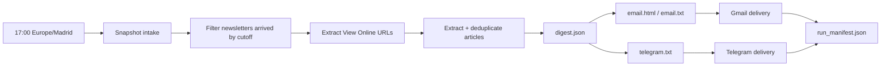

# Workflow Codex Daily Digest

Este proyecto tiene ahora dos modos:

1. `Producción diaria`: snapshot fijo a las `17:00` en `Europe/Madrid`, render HTML para Gmail, y resumen híbrido para Telegram.
2. `Manual fallback`: extractor + handoff a ChatGPT.

## Diagrama



## Roles

### Codex

- lee Gmail vía IMAP;
- selecciona todas las newsletters TLDR-family llegadas antes de las `17:00` Madrid;
- extrae las URLs `View Online`;
- descarga la versión web completa;
- elimina sponsors, ads, footer y ruido de tracking;
- resuelve URLs canónicas cuando es posible;
- deduplica artículos entre newsletters;
- produce `articles.json` y `run_manifest.json`;
- genera `digest.json` con ayuda de Codex;
- renderiza `email.html` y `telegram.txt`;
- entrega el resultado a Gmail y Telegram.

### ChatGPT

- queda como camino manual opcional cuando quieras pegar `output/editorial_handoff.md` y trabajar el digest fuera del pipeline de producción.
- los prompts heredados de este camino viven en `docs/legacy/`.

## Flujo de producción

### 1. Snapshot diario

```bash
python src/run_daily_digest.py snapshot
```

Esto crea `output/runs/YYYY-MM-DD/` y guarda:

- `source_messages.json`
- `articles.json`
- `run_manifest.json`

Regla central:

- el digest del día es un snapshot fijo
- se incluyen todas las newsletters TLDR-family configuradas que hayan llegado antes de las `17:00` Madrid
- no existe un bundle obligatorio de feeds diarios
- lo que llegue después entra en el digest del día siguiente
- la publicación programada corre `solo de lunes a viernes`

### 2. Generar `digest.json`

Codex debe leer `articles.json` y escribir `digest.json` para ese run dir.

Contrato editorial:

- `executive_summary`
- `principal_articles`
- `secondary_articles`
- `extraction_notes`

Para los artículos principales:

- primero el resumen original de TLDR en `tldr_summary`
- luego `why_important`

### 3. Renderizar y entregar

```bash
python src/run_daily_digest.py finalize
```

Salida esperada:

- `email.html`
- `email.txt`
- `telegram.txt`
- `run_manifest.json` actualizado con el estado de entrega

Orden de entrega:

- primero email
- después Telegram

## Flujo manual fallback

### 1. Ejecutar el extractor

```bash
python src/extract_tldr.py --url "URL_1" --url "URL_2" --out output/articles.json
```

### 2. Construir el handoff

```bash
python src/build_editorial_handoff.py --articles output/articles.json --out output/editorial_handoff.md
```

## Contrato del pipeline diario

### Entrada a Codex

- Gmail inbox
- feed allowlist
- credenciales SMTP
- credenciales Telegram bot

### Salida de Codex

- `output/runs/YYYY-MM-DD/articles.json`
- `output/runs/YYYY-MM-DD/digest.json`
- `output/runs/YYYY-MM-DD/email.html`
- `output/runs/YYYY-MM-DD/telegram.txt`
- digest entregado a Gmail y Telegram

## Qué sigue pendiente

- ampliar tests si cambia la estructura HTML de TLDR o el formato de Gmail
- mantener el fallback manual solo como camino de depuración
- revisar el allowlist si se activa un feed nuevo como `Hardware`
